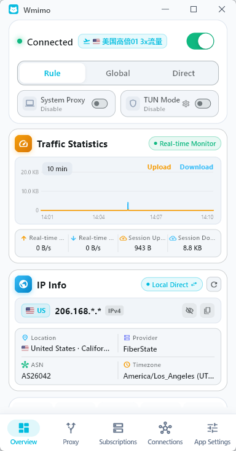

<div align="center">

[**简体中文**](README.zh-CN.md) | [**English**](README.md) | [**繁體中文**](README.zh-TW.md) | [**日本語**](README.ja.md) | [**한국어**](README.ko.md) | [**Русский**](README.ru.md) | [**Español**](README.es.md) | [**العربية**](README.ar.md) | [**فارسی**](README.fa.md)

</div>

---

<div align="center">
  
  <h1>Wmimo</h1>
  <p><strong>عميل وكيل Clash / Mihomo متعدد المنصات من الجيل الجديد</strong></p>
  <p>مبني باستخدام Flutter ونواة Mihomo (v1.19.34). تنفيذ محلي بالكامل بدون تتبع، مع وكيل متسلسل متعدد القفزات، وتشخيص متزامن للشبكة، واختبار سرعة برسم بياني حي.</p>

  <p>
    <a href="https://github.com/aimy1/Wmimo/stargazers"></a>
    <a href="https://github.com/aimy1/Wmimo/releases"></a>
    <a href="https://github.com/aimy1/Wmimo/actions/workflows/release.yml"></a>
    <a href="https://github.com/aimy1/Wmimo/releases"></a>
    <a href="https://github.com/MetaCubeX/mihomo"></a>
    <a href="LICENSE"></a>
    <a href="https://t.me/wmimoapp"></a>
  </p>

  <p>
    <a href="https://github.com/aimy1/Wmimo/releases"><b>التحميل</b></a> ·
    <a href="#sec-platforms"><b>المنصات</b></a> ·
    <a href="#sec-features"><b>المميزات</b></a> ·
    <a href="#sec-quickstart"><b>البدء السريع</b></a> ·
    <a href="#sec-build"><b>البناء</b></a> ·
    <a href="#sec-security"><b>الأمان والترخيص</b></a> ·
    <a href="#sec-community"><b>المجتمع</b></a>
  </p>
</div>

| الوضع الفاتح | الوضع الداكن |
| :---: | :---: |
|  |  |

<p align="center"><sub><em>تصميم بطاقات 18px · رسم بياني حي لحركة البيانات · محرك مزدوج TUN ووكيل النظام</em></sub></p>

---

<a id="sec-platforms"></a>

## المنصات المدعومة وحزم الإصدار

| النظام | المعمارية | حزم التنزيل | أبرز المزايا |
| :--- | :--- | :--- | :--- |
| **Windows** | `x64`, `arm64` | مثبت (`.exe`)، نسخة محمولة (`.zip`) | وكيل نظام بدون صلاحيات، Wintun WHQL TUN (مسؤول)، أداة UWP، شريط مهام متكيف، اختصارات عامة |
| **macOS** | `Universal` (`arm64` + `x64`) | `.dmg`، محمولة (`.zip`) | تفويض خدمة آمن/TUN، أيقونة شريط قوائم متكيفة، مزامنة iCloud Drive، اختصارات عامة |
| **Linux** | `x64`, `arm64` | `.deb`, `.rpm`, `.AppImage`, Arch `PKGBUILD` (`wmimo-bin`), `.tar.gz` | `setcap` / TUN، وكيل النظام، واجهة GTK3، اختصارات عامة |
| **Android** | `arm64-v8a`, `armeabi-v7a`, `x86_64` | ملفات APK حسب المعمارية ونسخة شاملة `.apk` | تبديل فوري لوكيل التطبيقات دون إعادة تشغيل النواة، استثناء البطارية، لوحة الإعدادات السريعة |
| **iOS** | `arm64` | ملف `.ipa` غير موقع (TrollStore / Sideload) | نفق Network Extension VPN ومزامنة iCloud ([docs/APPLE_DEVELOPMENT.md](docs/APPLE_DEVELOPMENT.md)) |

> حمّل الإصدارات من [GitHub Releases](https://github.com/aimy1/Wmimo/releases) وتحقق من بصمات APK SHA-256 وWintun في [SECURITY.md](SECURITY.md).

---

<a id="sec-features"></a>

## مصفوفة القدرات والمميزات الأساسية

| الوحدة | أبرز القدرات |
| :--- | :--- |
| **نواة Mihomo (`v1.19.34`)** | SS, VMess, VLESS Reality, Trojan, Hysteria 1/2, TUIC v5, WireGuard, SSH • تحليل عبر Isolate (`5,000` عقدة في `~163 ms`) |
| **الوكيل المتسلسل `[Beta]`** | يعتمد على **`dialer-proxy`** متعدد القفزات، إعادة ترتيب القفزات، منع التكرار، حفظ مستقل في `chain_proxies.json` |
| **وكيل التطبيقات (Android)** | حماية من تسرب القائمة البيضاء الفارغة، تحديث فوري أثناء تشغيل VPN، قوائم تطبيقات جاهزة بدون أذونات إضافية |
| **تشخيص الشبكة (`NetCheck`)** | فحص متزامن من 5 مراحل (تصفية محولات TUN، فحص DNS وFake-IP، المنافذ، الوكيل/TUN، العقدة النشطة) + إصلاح تلقائي بضغطة واحدة |
| **اختبار السرعة (`SpeedTest`)** | تحميل/رفع متعدد المسارات، قياس Ping/Jitter دقيق، منحنى سرعة حي، تقييم الاستخدام، وفحص زمن استجابة الخوادم |
| **النسخ الاحتياطي والمزامنة** | WebDAV وiCloud Drive وتصدير/استيراد `.zip` مع `chain_proxies.json`، استخراج تجريبي آمن وحماية Zip-Slip |
| **الواجهة والمراقبة** | الوضع الفاتح والداكن، إدارة بطاقات الرئيسية، تدوير الشاشة مفعّل افتراضياً، إخفاء عنوان IP |
| **الخصوصية و9 لغات** | بدون أي حزم تتبع أو إعلانات؛ **9 لغات × 898 مفتاحاً (100%)** مع 9 سياسات خصوصية مترجمة |

---

<a id="sec-quickstart"></a>

## البدء السريع

1. **التنزيل**: احصل على حزمة نظامك من [GitHub Releases](https://github.com/aimy1/Wmimo/releases).
2. **استيراد الاشتراك**: أضف رابط Clash/Mihomo أو ملف YAML من قسم الاشتراكات.
3. **الاتصال**: فعّل المفتاح الرئيسي في الواجهة الرئيسية.

<details>
<summary><b>إرشادات المنصات (Windows / Android / macOS وLinux / iOS)</b></summary>

- **Windows**: يعمل وكيل النظام بدون صلاحيات مسؤول؛ يتطلب وضع TUN التشغيل كمسؤول. أنشئ مجلد `portable` للوضع المحمول.
- **Android**: يُنصح باستثناء التطبيق من تحسين البطارية؛ تغييرات وكيل التطبيقات تُطبّق فوراً.
- **iOS**: يتوفر كملف `.ipa` غير موقع ([docs/APPLE_DEVELOPMENT.md](docs/APPLE_DEVELOPMENT.md)).

</details>

---

<a id="sec-build"></a>

## البناء من المصدر

- [Flutter SDK](https://flutter.dev/docs/get-started/install) (`>= 3.35.0`) و[Dart SDK](https://dart.dev/get-dart) (`>= 3.12.2`)
- أدوات بناء المنصة (VS 2022 C++ / Xcode / GTK3 & CMake / Android SDK)

```bash
git clone https://github.com/aimy1/Wmimo.git && cd Wmimo
flutter pub get && dart run slang
dart run tool/download_all_cores.dart
flutter run
# Release: flutter build {windows|macos|linux|apk} --release
```

---

## معايير الأداء والتحقق

- **سرعة التحليل**: `~30,670 عقدة/ث` (`5,000` عقدة خلال `~163 ms`).
- **اكتمال اللغات**: **9/9 لغات × 898 مفتاحاً = 100.0%** ([docs/BENCHMARKS.md](docs/BENCHMARKS.md)).

تفاصيل الاختبارات: [docs/BENCHMARKS.md](docs/BENCHMARKS.md).

---

## تاريخ النجوم (Star History)

[](https://star-history.com/#aimy1/Wmimo&Date)

---

<a id="sec-security"></a>

## الأمان والخصوصية والترخيص

- **عدم جمع البيانات**: [assets/txts/privacy_policy_ar.txt](assets/txts/privacy_policy_ar.txt)
- **التحقق من البصمات**: [SECURITY.md](SECURITY.md)
- مرخص بموجب **GNU General Public License v3.0 (GPL-3.0-or-later)** ([LICENSE](LICENSE)).
- حزم Rust: [MIT](rust/LICENSE-MIT) أو [Apache-2.0](rust/LICENSE-APACHE) منفردة، وGPL-3.0 ضمن Wmimo.
- مكونات الطرف الثالث: [THIRDPARTY_LICENSES.md](THIRDPARTY_LICENSES.md)، [docs/LICENSES_AND_COMPONENTS.md](docs/LICENSES_AND_COMPONENTS.md)

---

<a id="sec-community"></a>

## المجتمع والدعم

- **الموقع الرسمي**: [wmimo.buzz](https://wmimo.buzz) · **قناة Telegram**: [t.me/wmimoapp](https://t.me/wmimoapp) · **البريد الإلكتروني**: [aisaniya@proton.me](mailto:aisaniya@proton.me) · **الإبلاغ عن المشكلات**: [GitHub Issues](https://github.com/aimy1/Wmimo/issues)

**شكر وتقدير**: **[GooRingX (vowe)](https://github.com/GooRingX)** · **[Mihomo (MetaCubeX)](https://github.com/MetaCubeX/mihomo)** · **[Flutter](https://flutter.dev/)**
