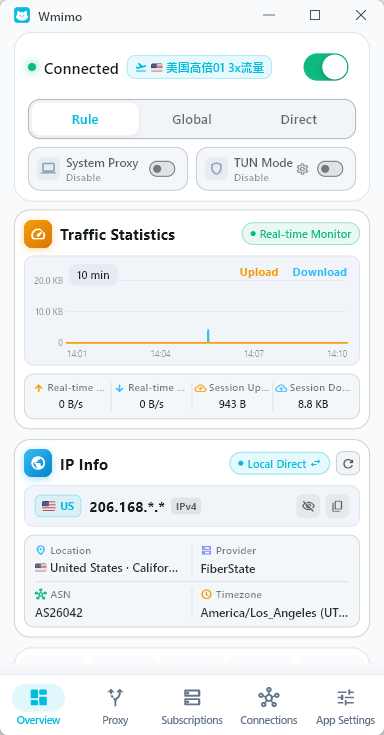
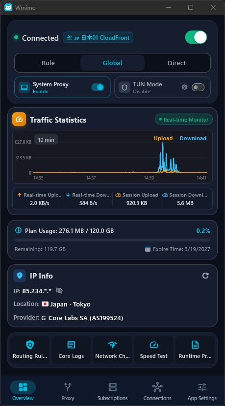

# Wmimo

<div align="center">

[**简体中文**](README.zh-CN.md) | [**English**](README.md) | [**繁體中文**](README.zh-TW.md) | [**日本語**](README.ja.md) | [**한국어**](README.ko.md) | [**Русский**](README.ru.md) | [**Español**](README.es.md) | [**العربية**](README.ar.md) | [**فارسی**](README.fa.md)

</div>

---


<div align="center">
  
  <h1 align="center" style="font-weight: 800; border-bottom: none; margin-top: 12px; margin-bottom: 6px;">Wmimo</h1>
  <p align="center" style="font-size: 1.15rem; color: #57606a;"><strong>次世代クロスプラットフォーム Clash / Mihomo プロキシクライアント</strong></p>
  <p align="center">Flutter と高性能 Mihomo (Meta) コアで構築。圧倒的なスピード、洗練されたモダンUI、そして豊富な全プロトコル対応を実現。</p>

  <p align="center">
    <a href="https://github.com/aimy1/Wmimo/releases"></a>
    <a href="https://github.com/aimy1/Wmimo/actions"></a>
    <a href="https://github.com/aimy1/Wmimo/releases"></a>
    <a href="https://flutter.dev"></a>
    <a href="https://github.com/aimy1/Wmimo/blob/main/LICENSE"></a>
    <a href="https://t.me/wmimoapp"></a>
  </p>

  <p align="center">
    <a href="https://github.com/aimy1/Wmimo/releases"><b>ダウンロード</b></a> •
    <a href="https://wmimo.buzz"><b>公式サイト</b></a> •
    <a href="#主な機能"><b>主な機能</b></a> •
    <a href="docs/BENCHMARKS.md"><b>ベンチマーク</b></a> •
    <a href="#クイックスタート"><b>クイックスタート</b></a> •
    <a href="#ソースからのビルド"><b>ビルド</b></a> •
    <a href="https://t.me/wmimoapp"><b>コミュニティ</b></a>
  </p>

  <br/>
  <p align="center">
    
    &nbsp;&nbsp;
    
  </p>
  <sub><em>18px マイクロカードデザイン、リアルタイムのベジェ曲線トラフィックモニター、高度なネットワーク診断（ライト＆ダーク両対応）</em></sub>
</div>

---

## 主な機能

- **洗練されたマイクロカードUIとネイティブデュアルテーマ**:
  - 美しい18px角丸マイクロカードレイアウトと洗練されたシアンブルーのアクセントカラー。
  - クリーンなライトテーマと深みのあるダークテーマをシームレスに切り替え。
  - 大画面デスクトップサイドバーとモバイル向けエルゴノミックレイアウトに自動適応。
- **高性能 Mihomo (Meta) コア**:
  - **Shadowsocks, VMess, VLESS (Reality), Trojan, Hysteria 1/2, TUIC v5, WireGuard, SSH, Direct** などを完全サポート。
  - ノード解析とソートをバックグラウンド Isolate で非同期処理 — UIスレッドをブロックせず高速ロード（5,000ノードを約163msで処理、詳細は [ベンチマーク](docs/BENCHMARKS.md) を参照）。
- **柔軟なルーティングとデュアルプロキシエンジン**:
  - ワンタップでルーティング切替: **ルール分流 (Rule)** / **グローバル (Global)** / **ダイレクト (Direct)**。
  - **TUN 仮想アダプターモード**（システム全体の透過プロキシ）と **システムプロキシモード**（権限不要の軽快接続）。
  - Android アプリ別プロキシ設定、Windows UWP Loopback 免除ユーティリティ。
- **リアルタイムトラフィック監視と総合ネットワーク診断**:
  - 1分/5分/15分/30分/60分のマルチスパンに対応した滑らかなベジェ曲線トラフィックグラフ。
  - 出口 IP、地域、ISP 情報を瞬時に取得し、プライバシー保護のマスキングとワンタップコピーに対応。
  - サブスクリプション通信量の進捗バーと有効期限カウントダウン。
  - 充実の診断ツール: ルーティングルール検査、コアリアルタイムログ、並行Pingテスト、ランタイム設定ビューア。
- **OSネイティブ機能とのシームレスな統合**:
  - **Windows**: アプリのテーマに自動追従するタスクトレイメニュー、トレイアイコンでのリアルタイム速度表示、`comctl32 v6` スタイル。
  - **Android**: フォアグラウンド通知によるワンタップ切断、クイック設定タイル、多言語リアルタイム同期。
  - **macOS**: メニューバーの Template アイコン対応とシステムプロキシ自動化。
- **マルチチャネル自動アップデート**:
  - `stable`（安定版）と `beta`（プレビュー版）チャンネルを自由に切り替え。
  - バックグラウンドでの高速サイレントダウンロードと SHA-256 ハッシュ整合性検証。
- **完全な 9 言語ネイティブ対応**:
  - 簡体字中国語、繁体字中国語、英語、日本語、韓国語、ロシア語、スペイン語、アラビア語、ペルシャ語の 798 キーを完全カバー（0 欠損キー、[ベンチマーク](docs/BENCHMARKS.md) 参照）。

---

## クイックスタート

1. **ダウンロード**: [Releases ページ](https://github.com/aimy1/Wmimo/releases) からお使いのOSに合ったパッケージを入手します。
2. **サブスクリプション登録**: 「サブスクリプション」画面でリンクを貼り付けるか YAML プロファイルを読み込みます。
3. **接続**: 「ホーム」画面の接続トグルをタップするだけで高速プロキシ通信が始まります。
   - *Windows の注意点*: **TUN モード** を使用する場合は右クリックから【管理者として実行】してください。通常利用は **システムプロキシモード** の利用を推奨します。

---

## ソースからのビルド

### 前提条件
- [Flutter SDK](https://flutter.dev/docs/get-started/install) (`>= 3.35.0`)
- [Dart SDK](https://dart.dev/get-dart) (`>= 3.12.2`)
- 各プラットフォーム向けコンパイラ環境（Windows: Visual Studio 2022 C++、Linux: GTK3/Clang/CMake、Android: Android SDK）

### クイックコマンド

```bash
# 1. リポジトリのクローン
git clone https://github.com/aimy1/Wmimo.git
cd Wmimo

# 2. 依存関係の取得と多言語コード生成
flutter pub get
dart run slang

# 3. 各プラットフォーム向け Mihomo コアのダウンロード
dart run tool/download_all_cores.dart

# 4. 開発実行
flutter run

# 5. リリースバイナリのビルド
flutter build windows --release   # Windows
flutter build apk --release       # Android
flutter build linux --release     # Linux
flutter build macos --release     # macOS
```

---

## Star History

[](https://star-history.com/#aimy1/Wmimo&Date)

---

## パフォーマンスと品質検証

Wmimo のアーキテクチャ効率とカバレッジは、再現可能な自動テストスイートによって継続的に検証されています：

- **サブスクリプション解析スループット**: 約 30,670 ノード/秒（バックグラウンド Isolate により、5,000 個の複数プロトコルノードを約 163ms で解析・分類）。
- **高速フォーマット判別**: `isClashYaml` による 1,000 ノード検証が約 1.4ms で完了。
- **多言語対応の完全性**: 全 9 言語において 798/798 キーで 100.0% の一致を達成（未翻訳キー 0）。
- **ローカルでの検証実行**: `flutter test test/benchmark_profile_scale_test.dart` および `flutter test test/i18n_integrity_test.dart`。

検証手法の詳細およびハードウェア仕様は [docs/BENCHMARKS.md](docs/BENCHMARKS.md) をご覧ください。

---

## 謝辞

- **[GooRingX (vowe)](https://github.com/GooRingX)**: 卓越したオープンソース貢献、アーキテクチャの知見、デザインのインスピレーションに感謝します。
- **[Mihomo (MetaCubeX)](https://github.com/MetaCubeX/mihomo)**: 優れたコアエンジンと充実したプロトコル対応に感謝します。
- **[Flutter](https://flutter.dev/)**: 優れたクロスプラットフォームUIフレームワークを提供してくれたチームに感謝します。

---

## コミュニティとサポート

- **公式サイト**: [wmimo.buzz](https://wmimo.buzz)
- **Telegram 公式チャンネル**: [t.me/wmimoapp](https://t.me/wmimoapp)
- **お問い合わせ**: [aisaniya@proton.me](mailto:aisaniya@proton.me)
- **バグ報告・提案**: [GitHub Issues](https://github.com/aimy1/Wmimo/issues)

---

## ライセンス

本プロジェクトは **GNU General Public License v3.0 (GPL-3.0-or-later)** のもとで公開されています。詳細は [LICENSE](LICENSE) をご覧ください。

- **Rust Workspace クレート**: 単体利用時は [MIT](rust/LICENSE-MIT) または [Apache-2.0](rust/LICENSE-APACHE) のデュアルライセンス、Wmimo とともに配布される場合は GPL-3.0 が適用されます。
- **サードパーティおよびコアコンポーネントのライセンス**: [THIRDPARTY_LICENSES.md](THIRDPARTY_LICENSES.md) および [docs/LICENSES_AND_COMPONENTS.md](docs/LICENSES_AND_COMPONENTS.md) をご参照ください。
