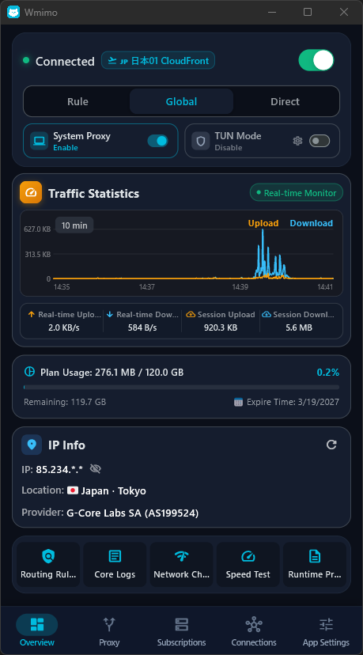

<div align="center">

[**简体中文**](README.zh-CN.md) | [**English**](README.md) | [**繁體中文**](README.zh-TW.md) | [**日本語**](README.ja.md) | [**한국어**](README.ko.md) | [**Русский**](README.ru.md) | [**Español**](README.es.md) | [**العربية**](README.ar.md) | [**فارسی**](README.fa.md)

</div>

---

<div align="center">
  
  <h1>Wmimo</h1>
  <p><strong>新一代全平台 Clash / Mihomo 桌面与移动端代理客户端</strong></p>
  <p>基于 Flutter 与 Mihomo (v1.19.34) 核心构建。坚持数据零遥测与纯本地执行，集多跳链式代理、并发链路诊断、实时波形测速与系统级原生融合于一体。</p>

  <p>
    <a href="https://github.com/aimy1/Wmimo/stargazers"></a>
    <a href="https://github.com/aimy1/Wmimo/releases"></a>
    <a href="https://github.com/aimy1/Wmimo/actions/workflows/release.yml"></a>
    <a href="https://github.com/aimy1/Wmimo/releases"></a>
    <a href="https://github.com/MetaCubeX/mihomo"></a>
    <a href="LICENSE"></a>
    <a href="https://t.me/wmimoapp"></a>
  </p>

  <p>
    <a href="https://github.com/aimy1/Wmimo/releases"><b>下载发布版</b></a> ·
    <a href="#sec-platforms"><b>支持平台</b></a> ·
    <a href="#sec-features"><b>核心能力</b></a> ·
    <a href="#sec-quickstart"><b>快速上手</b></a> ·
    <a href="#sec-build"><b>源码编译</b></a> ·
    <a href="#sec-security"><b>安全与许可</b></a> ·
    <a href="#sec-community"><b>社区反馈</b></a>
  </p>
</div>

| 浅色主题 (Light) | 深色主题 (Dark) |
| :---: | :---: |
|  |  |

<p align="center"><sub><em>18px 极简微卡片仪表盘 · 实时贝塞尔流量曲线 · TUN / 系统代理双引擎 · 支持自定义首页卡片与横竖屏自适应</em></sub></p>

---

<a id="sec-platforms"></a>

## 支持平台与发布产物清单

| 操作系统 | 支持架构 | 官方发布包格式 | 平台专属特性 |
| :--- | :--- | :--- | :--- |
| **Windows** | `x64`, `arm64` | 安装程序 (`.exe`)、便携压缩包 (`.zip`) | 免特权系统代理、WHQL 签名 Wintun TUN（管理员）、UWP 回环豁免、深浅色同步托盘与实时网速、全局快捷键 |
| **macOS** | `Universal` (`arm64` + `x64`) | `.dmg` 镜像、便携压缩包 (`.zip`) | 安全服务提权与 TUN、系统代理、自适应菜单栏图标、iCloud Drive 云端备份同步、全局快捷键 |
| **Linux** | `x64`, `arm64` | `.deb`, `.rpm`, `.AppImage`, Arch `PKGBUILD` (`wmimo-bin`), `.tar.gz` | `setcap` / 服务提权 TUN 模式、系统代理、GTK3 桌面集成、全局快捷键 |
| **Android** | `arm64-v8a`, `armeabi-v7a`, `x86_64` | 分架构 APK 与通用版 `.apk` | 不断流分应用代理热更新（黑白名单 + 免授权预设）、电池优化保活检测、快捷设置磁贴、前台通知控制 |
| **iOS** | `arm64` | 未签名 `.ipa`（巨魔 / 自签侧载） | Network Extension VPN 隧道、iCloud Drive 同步（详见 [Apple 开发指南](docs/APPLE_DEVELOPMENT.md)） |

> 请前往 [GitHub Releases](https://github.com/aimy1/Wmimo/releases) 下载对应平台安装包，并参考 [SECURITY.md](SECURITY.md) 校验 Android APK SHA-256 签名指纹与 Wintun 驱动签名。

---

<a id="sec-features"></a>

## 核心能力矩阵与特性详解

| 功能模块 | 核心能力摘要 |
| :--- | :--- |
| **Mihomo 路由内核** | `v1.19.34` • 覆盖 SS、VMess、VLESS (Reality)、Trojan、Hysteria 1/2、TUIC v5、WireGuard、SSH、Direct；独立 Isolate 解析订阅（5,000 节点仅 ~163 ms） |
| **多跳链式代理 `[Beta]`** | 基于 **`dialer-proxy`** 链式编排（入口策略/节点 ➔ 任意中转跳 ➔ 出口落地），支持拖拽换序、重复节点/策略组校验，`chain_proxies.json` 独立持久化不受订阅更新影响 |
| **移动端分应用代理** | 白名单空列表防漏流保护；VPN 运行期句柄平滑热替换无需重启核心；应用列表 + Launcher 去重探测与常用应用免授权预设 |
| **网络链路诊断 (`NetCheck`)** | 两阶段 5 步并发体检（自动过滤虚拟 TUN 网卡、DNS 与 Fake-IP `198.18.0.0/15` 检测、核心端口、代理/TUN 对齐、真实出口 204 握手含兜底）+ 并发单域名排查 + 一键自愈 |
| **内置网络测速 (`SpeedTest`)** | 多流并发 HTTP 下载/上传测速、同主机稳态 Ping/抖动采样、实时上下行双线波形曲线、场景评级（电竞/8K/会议）、选服并发延迟徽标与代理前置校验 |
| **备份与云端同步** | 支持 WebDAV、iCloud Drive（iOS/macOS）、本地与 URL 导入导出 `.zip`；纳入链式代理配置，预解压临时校验防毁损，严格防 Zip-Slip 路径穿越 |
| **微卡片 UI 与流量监控** | 原生浅色/深黑双主题、可定制首页卡片管理器、默认开启跟随屏幕旋转、1m–60m 多尺度贝塞尔流量波纹图、出口 IP 归属与隐私脱敏卡片 |
| **隐私零收集与 9 国语言** | 零广告与遥测 SDK，全链路本地运行；**9 种语言 × 898 词条 100% 对齐**，并内置全 9 语种独立《隐私政策》与《用户协议》视图 |

---

<a id="sec-quickstart"></a>

## 三步快速上手

1. **下载安装**：前往 [GitHub Releases](https://github.com/aimy1/Wmimo/releases) 获取对应操作系统安装包。
2. **导入配置**：进入「订阅配置」，粘贴 Clash/Mihomo 订阅链接或导入本地 YAML 文件。
3. **连接使用**：点击「首页」主连接开关即可启用代理分流。

<details>
<summary><b>各平台使用与排障贴士（Windows / Android / macOS & Linux / iOS）</b></summary>

- **Windows**: 日常可直接使用免提权 **系统代理模式**；如需 **TUN 虚拟网卡** 全局接管，请右键「以管理员身份运行」。在 `wmimo.exe` 同级目录新建 `portable` 文件夹或在设置开启便携模式即可绿色运行。
- **Android**: 建议在系统设置中将 Wmimo 设为「忽略电池优化」以保证后台断流防护；进入 **分应用代理** 修改黑白名单后返回或在页面内应用即可热生效，无需断开内核重连。
- **macOS / Linux**: 开启 TUN 虚拟网卡首次需要授予核心服务权限，应用已通过安全的环境变量与标准输入通道调用系统授权弹窗。
- **iOS**: 发布产物为未签名 `.ipa`，可通过 TrollStore 巨魔或个人开发者证书重签安装，详见 [docs/APPLE_DEVELOPMENT.md](docs/APPLE_DEVELOPMENT.md)。

</details>

---

<a id="sec-build"></a>

## 本地源码编译

- [Flutter SDK](https://flutter.dev/docs/get-started/install) (`>= 3.35.0`) 与 [Dart SDK](https://dart.dev/get-dart) (`>= 3.12.2`)
- 目标平台编译器：Visual Studio 2022 C++（Windows）、Xcode（macOS/iOS）、GTK3/Clang/CMake/Ninja（Linux）、Android SDK & NDK（Android）

```bash
git clone https://github.com/aimy1/Wmimo.git && cd Wmimo
flutter pub get && dart run slang
dart run tool/download_all_cores.dart
flutter run
# Release: flutter build {windows|macos|linux|apk} --release
```

---

## 性能基准与自动化验证

- **高吞吐订阅解析**：`~30,670 节点/秒` —— 后台 Isolate 解析与归类 `5,000` 个多协议节点仅耗时 `~163 ms`，不阻塞 UI 渲染帧。
- **极速格式探测**：`SubscriptionConverter.isClashYaml` 在 `1,000` 节点规模下仅耗时 `~1.4 ms`。
- **9 国语言零缺失**：**9/9 语种 × 898 词条 = 100.0% 覆盖率**，且 9 语种《隐私政策》与《用户协议》全部对齐。
- **本地一键验证**：依次运行 `flutter analyze --no-pub lib/ third_party/libclash_vpn_service/lib/ test/`、`flutter test test/benchmark_profile_scale_test.dart`、`flutter test test/i18n_integrity_test.dart` 与 `dart run tool/verify_i18n.dart`。

完整基准测试方法与硬件环境说明请参阅 [docs/BENCHMARKS.md](docs/BENCHMARKS.md)。

---

## Star 增长趋势图

[](https://star-history.com/#aimy1/Wmimo&Date)

---

<a id="sec-security"></a>

## 隐私承诺、安全校验与开源许可

- **隐私零收集承诺**：所有路由、DNS 与诊断计算均在本机完成，无任何商业统计或追踪 SDK，详见 [assets/txts/privacy_policy_cn.txt](assets/txts/privacy_policy_cn.txt)。
- **官方产物验签**：请参阅 [SECURITY.md](SECURITY.md) 核对官方 Android APK SHA-256 签名证书指纹及 Wintun WHQL 签名说明。
- 本项目依据 **GNU General Public License v3.0 (GPL-3.0-or-later)** 开源发布，详情见 [LICENSE](LICENSE)。
- **Rust Workspace 模块**：独立使用时采用 [MIT](rust/LICENSE-MIT) OR [Apache-2.0](rust/LICENSE-APACHE) 双重许可；随 Wmimo 编译分发时受 GPL-3.0 约束。
- **第三方组件与核心声明**：请参阅 [THIRDPARTY_LICENSES.md](THIRDPARTY_LICENSES.md) 与 [docs/LICENSES_AND_COMPONENTS.md](docs/LICENSES_AND_COMPONENTS.md)。

---

<a id="sec-community"></a>

## 社区交流与支持

- **官方网站**: [wmimo.buzz](https://wmimo.buzz) · **Telegram 官方频道**: [t.me/wmimoapp](https://t.me/wmimoapp) · **开发者邮箱**: [aisaniya@proton.me](mailto:aisaniya@proton.me) · **问题反馈 (Issues)**: [GitHub Issues](https://github.com/aimy1/Wmimo/issues)

**致谢**: **[GooRingX (vowe)](https://github.com/GooRingX)** —— 感谢杰出的开源贡献、架构见解与设计灵感。 · **[Mihomo (MetaCubeX)](https://github.com/MetaCubeX/mihomo)** —— 感谢强大的跨平台代理内核与协议支持。 · **[Flutter](https://flutter.dev/)** —— 感谢现代化的跨平台 UI 框架与社区。
