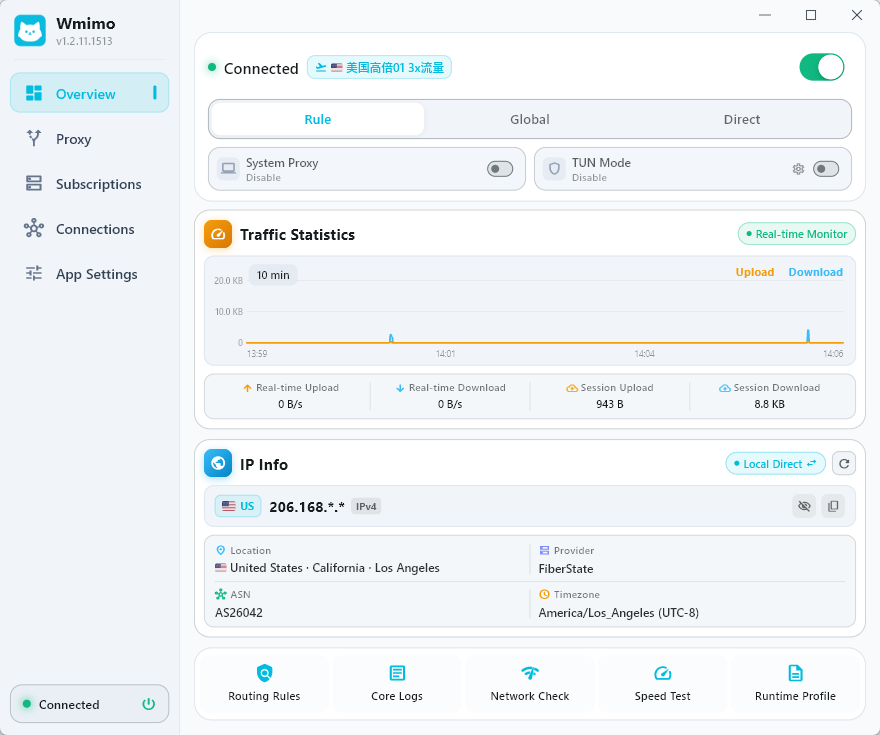

# Wmimo

<div align="center">

[**简体中文**](README.zh-CN.md) | [**English**](README.md) | [**繁體中文**](README.zh-TW.md) | [**日本語**](README.ja.md) | [**한국어**](README.ko.md) | [**Русский**](README.ru.md) | [**Español**](README.es.md) | [**العربية**](README.ar.md) | [**فارسی**](README.fa.md)

</div>

---


<div align="center">
  
  <h1 align="center" style="font-weight: 800; border-bottom: none; margin-top: 12px; margin-bottom: 6px;">Wmimo</h1>
  <p align="center" style="font-size: 1.15rem; color: #57606a;"><strong>新一代現代化跨平台 Clash / Mihomo 桌面與行動端代理客戶端</strong></p>
  <p align="center">基於 Flutter 與高效能 Mihomo (Meta) 核心傾力打造。兼具極速轉發效能、現代藝術級設計美學與全協議代理能力。</p>

  <p align="center">
    <a href="https://github.com/aimy1/Wmimo/releases"></a>
    <a href="https://github.com/aimy1/Wmimo/actions"></a>
    <a href="https://github.com/aimy1/Wmimo/releases"></a>
    <a href="https://flutter.dev"></a>
    <a href="https://github.com/aimy1/Wmimo/blob/main/LICENSE"></a>
    <a href="https://t.me/wmimoapp"></a>
  </p>

  <p align="center">
    <a href="https://github.com/aimy1/Wmimo/releases"><b>下載安裝</b></a> •
    <a href="#核心特性"><b>核心特性</b></a> •
    <a href="#快速上手"><b>快速上手</b></a> •
    <a href="#本地編譯與開發"><b>本地編譯</b></a> •
    <a href="https://t.me/wmimoapp"><b>官方社群</b></a>
  </p>

  <br/>
  <p align="center">
    
  </p>
  <p align="center">
    
    &nbsp;&nbsp;
    
  </p>
  <sub><em>18px 極簡微卡片設計體系 · 即時平滑流量貝塞爾曲線監控 · TUN & 系統代理雙模式（淺色 & 深色原生雙主題）</em></sub>
</div>

---

## 核心特性

- **藝術級微卡片介面與原生雙主題**：
  - 遵循 18px 精緻圓角微卡片排版體系與天青藍品牌視覺，現代高雅；
  - 原生支援極簡明亮（Light）與深邃暗黑（Dark）雙主題無縫切換；
  - 響應式自適應設計：桌面端寬螢幕側邊欄，行動端單手人體工學佈局。
- **高效能 Mihomo (Meta) 核心驅動**：
  - 全協議支援：**Shadowsocks, VMess, VLESS (Reality), Trojan, Hysteria 1/2, TUIC v5, WireGuard, SSH, Direct** 等；
  - 獨立後台 Isolate 平行處理節點與規則流，啟動過程 **零介面凍結（Zero UI Freeze）**，超低記憶體佔用。
- **智慧分流路由與系統級雙代理模式**：
  - 出站模式快速切換：**規則分流 (Rule)** / **全域代理 (Global)** / **直接連線 (Direct)**；
  - 雙引擎彈性調度：**TUN 虛擬網卡模式**（透明接管全系統流量）與 **系統代理模式**（免特權快速連線）；
  - 應用程式分流：Android 依應用程式代理（黑白名單）與 Windows UWP Loopback 免除工具。
- **即時流量監控與智慧診斷套件**：
  - 儀表板即時平滑貝塞爾流量曲線圖，支援 1m / 5m / 15m / 30m / 60m 跨度縮放；
  - 即時出口 IP、地理位置與 ISP 歸屬資訊卡片，一鍵測速與隱私脫敏保護；
  - 訂閱套餐用量即時進度條與到期時間精準倒數；
  - 完整診斷套件：路由規則檢視、核心即時主控台日誌、全節點平行測速與網路連通性診斷。
- **深度作業系統級原生整合**：
  - **Windows**：原生系統匣右鍵選單自動同步跟隨 App 深淺色主題，系統匣圖示動態顯示即時網速，現代 `comctl32 v6` 渲染；
  - **Android**：前景服務通知欄常駐（具即時狀態與中斷按鈕），支援下拉快捷開關磁貼，多語言即時聯動；
  - **macOS**：原生選單列自適應 Template 圖示支援與系統代理自動化。
- **智慧多通道無縫自動更新**：
  - 支援 `stable`（正式穩定通道）與 `beta`（測試預覽通道）自由切換；
  - 後台靜默高速下載、SHA-256 哈希完整性校驗與原地升級。
- **真正 100% 完整 9 國語言支援**：
  - 繁體中文、簡體中文、English、日本語、한국어、Русский、Español、العربية、فارسی 9 種語言 705 個詞條全量對齊。

---

## 快速上手

1. **下載安裝**：至 [Releases 頁面](https://github.com/aimy1/Wmimo/releases) 下載適用於您系統的安裝包；
2. **匯入訂閱**：進入「訂閱配置」介面，貼上您的 Clash / Mihomo 訂閱連結或匯入本地 YAML 設定檔；
3. **開啟連線**：在「首頁」輕觸頂部開關即可開啟代理。
   - *Windows 提示*：如需使用 **TUN 模式**，請按右鍵選擇【以管理員身分執行】應用；若日常免特權執行，直接開啟 **系統代理模式** 即可順暢連線。

---

## 本地編譯與開發

```bash
# 1. 複製程式碼庫
git clone https://github.com/aimy1/Wmimo.git
cd Wmimo

# 2. 安裝相依套件並產生多語言程式碼
flutter pub get
dart run slang

# 3. 下載全平台 Mihomo 核心
dart run tool/download_all_cores.dart

# 4. 本地啟動除錯
flutter run

# 5. 編譯正式發行套件
flutter build windows --release   # Windows
flutter build apk --release       # Android
flutter build linux --release     # Linux
flutter build macos --release     # macOS
```

---

## Star 成長趨勢

[](https://star-history.com/#aimy1/Wmimo&Date)

---

## 致謝

- **[GooRingX (vowe)](https://github.com/GooRingX)**：感謝傑出的開源貢獻與設計指導。
- **[Mihomo (MetaCubeX)](https://github.com/MetaCubeX/mihomo)**：感謝團隊提供的高效能核心。
- **[Flutter](https://flutter.dev/)**：感謝團隊與社群提供的優秀跨平台框架支援。

---

## 社群交流與回饋

- **Telegram 官方頻道**: [t.me/wmimoapp](https://t.me/wmimoapp)
- **聯絡信箱**: [aisaniya@proton.me](mailto:aisaniya@proton.me)
- **問題回報**: [提交 GitHub Issue](https://github.com/aimy1/Wmimo/issues)

---

## 開源授權

本專案採用 **GPL-3.0** 授權條款開源分發。詳細內容請參閱 [LICENSE](LICENSE) 檔案。
